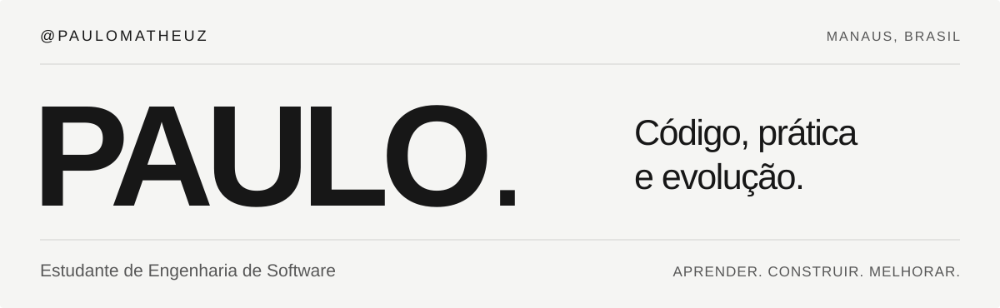

<picture>
  <source media="(max-width: 600px) and (prefers-color-scheme: dark)" srcset="assets/header-mobile-dark.svg">
  <source media="(max-width: 600px)" srcset="assets/header-mobile-light.svg">
  <source media="(prefers-color-scheme: dark)" srcset="assets/header-dark.svg">
  
</picture>

<h4 align="center">SOFTWARE ENGINEERING | SAMSUNG TECHNICAL CONSULTANT | PYTHON | AUTOMATION | APIs & INTEGRATIONS | SOFTWARE TESTING | APPLIED AI</h4>

 

  Sou estudante de Engenharia de Software e venho desenvolvendo minhas competências em Python, automação, integração com APIs e testes de software por meio de projetos práticos. Também estudo IA aplicada e busco escrever código organizado, tratar erros e documentar minhas implementações. Procuro um estágio ou minha primeira oportunidade em desenvolvimento de software para aprender com uma equipe e contribuir com os conhecimentos que venho construindo.

  
  

<i>“Prepara-se o cavalo para o dia da batalha, porém do Senhor vem a vitória!”</i>

